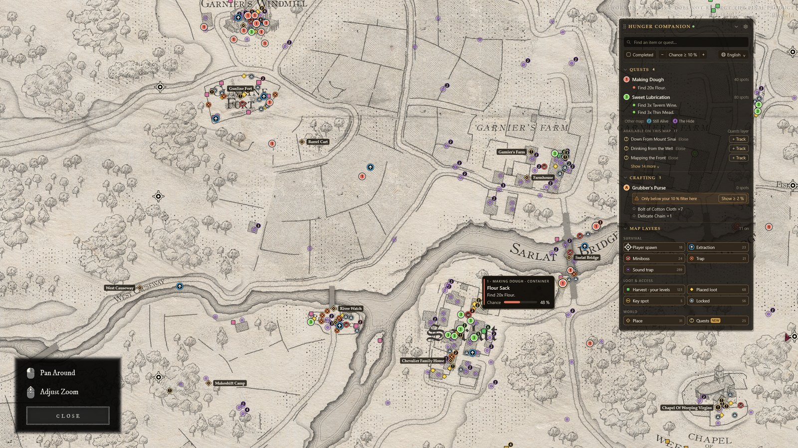
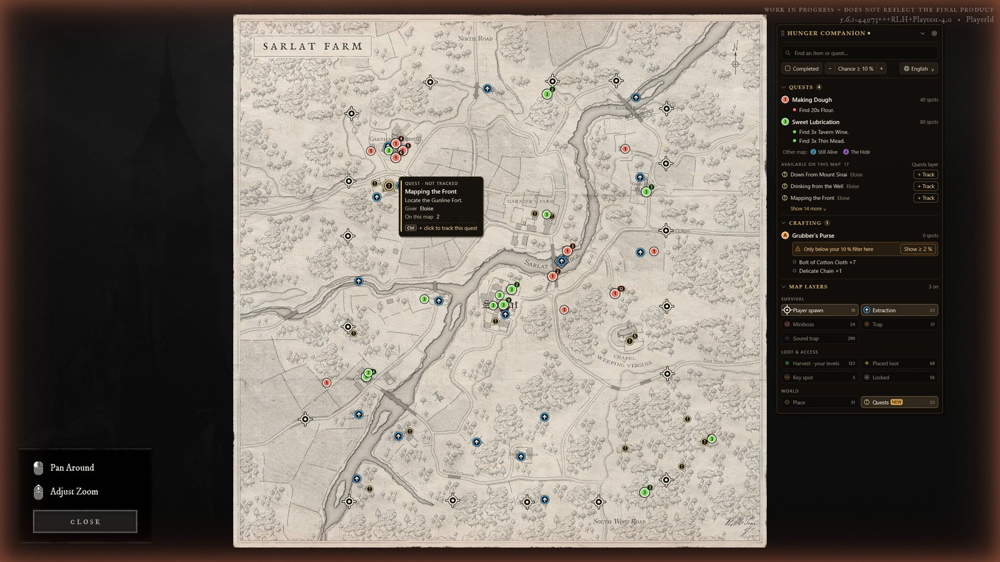
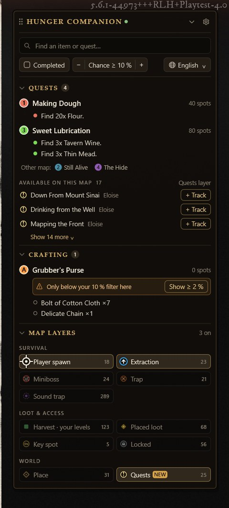

# Hunger Overlay

**Your [Hunger Companion](https://hunger-companion.com) quest tracker, drawn directly on top of the in-game map of
*Hunger*.**

Open the map in game: your tracked quests, the containers and harvest nodes that drop what you need, spawn points,
extractions and more appear exactly where they are, and they follow the map as you zoom and pan.



- **One small `.exe`** (about 1.5 MB). Nothing to install, no runtime, no administrator rights.
- **About 10 MB of RAM** while the map is closed.
- **It reads the screen only.** It never reads or modifies the game's memory or files, never injects anything into the
  game and never simulates input (see [What it does, and what it doesn't](#what-it-does-and-what-it-doesnt)).

## Features

- **Automatic map detection.** No key binding is needed: the app recognises the map on screen, whichever way you
  opened it (map key, *Inspect* in the Compendium…). It also recognises which of the three maps is open (Sarlat Farm,
  Jacques Bridge, Sombre Forest).
- **Follows zoom and pan.** It follows the mouse wheel and dragging, then re-aligns itself on the image every time the
  map stops moving (typical error: 1–2 px). If it ever loses track, it hides the markers and finds the map again.
- **Your quests, from your account.** It shows the quests you track on the site, their remaining objectives, and where
  to go or what to loot. Each quest has its own colour and number (1, 2, 3…), drawn inside its markers, so quests can
  be told apart even without relying on colour.
  - For loot objectives, it shows the containers with their drop chance. A slider sets the minimum chance.
  - It shows harvest nodes, greyed out when they are above your declared gathering level.
- **Readable on a busy map.** Every marker sits on a dark halo, each kind has its own shape (extraction, spawn, trap,
  key, lock, mini-boss…), nearby markers of the same quest are grouped with a count, and markers of different quests
  at the same spot are spread around it. Hovering a marker shows what it is, the drop chance and the objectives there.
- **Map panel**, in the game's own style. You can move it, collapse it and set its opacity. It also gives you:
  - quick settings (completed objectives, minimum chance, language);
  - one click to hide or show a quest, and hovering a quest highlights its markers on the map;
  - optional **layers**, in groups: spawn points, extractions, mini-bosses, traps, sound traps, placed loot, harvest
    (filtered by your levels), keys, locked doors and chests, places, and **Quests**.
- **Discover quests on the map.** The Quests layer shows where the quests you do not track yet take place. Track one
  with its **+ Track** button in the panel, or with **Ctrl + click** on its marker (with an Undo link). This needs a
  key that is allowed to change your tracking.
- **Quest journal.** Your progression per character, in the real play order, with the quests that depend on others:
  - **Up next** shows the first quest to do for each character; "Already done" marks it done and proposes the next one;
  - click a step to say "**I am here**": the earlier quests become done (shown before anything is saved);
  - every change is written to your hunger-companion.com account in one go, and **Undo** (with a history) puts
    everything back exactly as it was;
  - the panel shows a ✓ on each tracked quest and suggests the next quest when you finish one.
- **Raid allies** (up to 2, as raids hold 3 players): members of your hub on the website, or a friend without the app
  or an account whose quests you enter yourself. Their quests show on your map as hollow markers with their initial,
  and a small pip on your own marker when you share a spot for the same quest.
- **Find an item.** Type a name (in your language) and every place to find it appears on the map.
- **Find a quest.** Pick a quest in the same search window: an available quest is tracked at once, a locked or done
  one opens in the journal. Changing your progression needs a key that is allowed to change your tracking.
- **Crafting list** (site beta). Recipes you want to craft appear like quests, with their ingredients' locations.
- **Ten languages** for the game data. The interface is in English or French. "Auto" follows the Windows language
  (English when it is not offered), or you can pick one from a list.
- **Settings window** with a light or dark theme that follows Windows.
- **Automatic updates.** The new version is downloaded, its SHA-256 checked, and it is installed only when the map is
  not shown.

| Default view | Panel |
|---|---|
|  |  |

*Screenshots: the overlay's own drawing code, rendered over real screenshots of the game's map.*

## Getting started

1. On hunger-companion.com, sign in, then go to **Account → Security → Overlay key → Generate**.
2. Download `HungerOverlay.exe` from the [latest release](https://github.com/waibcam/hunger-overlay/releases/latest)
   and run it. It is not signed yet: Windows SmartScreen may ask you to confirm (*More info → Run anyway*).
3. Paste your key in the settings window that opens, then **Save**.
4. Play in **borderless / windowed fullscreen** mode. Exclusive fullscreen hides every overlay.
5. Open the map in game.

The tray icon (next to the clock) gives access to the settings, the quest journal, item and quest search, a manual
refresh, and Quit. `HungerOverlay.exe --journal` opens the journal at start (handy for a desktop shortcut).

## What it does, and what it doesn't

| | |
|---|---|
| **Reads** | Screen pixels of the game window (GDI `BitBlt`), only to recognise the map and its position. The mouse wheel and button events (Raw Input, passive): they are never blocked or modified. |
| **Draws** | A transparent, click-through window above the game, plus a small panel that does not take focus. |
| **Sends** | Your API key, in an `Authorization` header over HTTPS, to `hunger-companion.com` only. It is never sent in a URL and never written to the log. When you change your quest progression (track, done, undo…) or choose raid allies, the quest ids and states (or ally ids) are sent too, only on your click. No screenshots, input or game data are ever sent. |
| **Downloads** | Static JSON packs (quests, map calibrations, layers), your tracker, the items you search for, and updates listed in the site's `app.json`. An update is refused if its SHA-256 does not match. |
| **Stores** | `%APPDATA%\HungerOverlay\`: settings, a cache of the downloaded data, the undo history (last 20 changes, 7 days), allies without an account, a short log. The API key is encrypted with Windows DPAPI. |
| **Never** | Reads the game's memory or files, injects code, simulates keys or clicks, or runs anything with administrator rights. |

Network usage is deliberately tiny:
- The quest data is fetched once per launch, with an ETag, so it is only downloaded when it changes.
- Your tracker is fetched when the map opens: at most once every 30 s and 100 times per hour. Nothing is polled in the
  background.

> **Easy Anti-Cheat:** the app belongs to the same category as external overlays (Discord, Overwolf…), and it does
> even less, since it injects nothing. It is not affiliated with or endorsed by the game's developer: use it at your own
> risk.

## Building from source

Requirements: Windows 10/11, the stable Rust toolchain (MSVC) and Python 3 with Pillow and NumPy (only to rebuild the
assets).

```bash
cargo build --release          # → target/release/HungerOverlay.exe
```

- `tools/make_assets.py <atlas>` rebuilds the embedded map reference textures and the icon.
- `tools/mock_site.py <export>` runs a local fake site implementing the API contract. To use it, set
  `"base_url": "http://127.0.0.1:8787"` in `%APPDATA%\HungerOverlay\config.json`.
- Tests:
  - `cargo test --release` runs the unit tests;
  - `HUNGER_PREVIEW=<dir> cargo test --release preview -- --nocapture` draws the overlay and the panel offline from the
    cached data, as raw images to composite over a screenshot;
  - `HUNGER_RAWCAPS=<dir> cargo test --release real_captures -- --nocapture` replays real screenshots through the map
    recognition and re-alignment code.

### Source layout

| File | Role |
|---|---|
| `main.rs` | Application: windows, input, map state machine, drawing |
| `detect.rs`, `capture.rs`, `refs.rs` | Screen capture, map detection and identification, embedded references |
| `resync.rs` | Visual re-alignment (zoom and pan) on a background thread |
| `net.rs`, `model.rs` | Website API (contract v1.1) and data model |
| `panel.rs`, `render.rs` | Map panel and Direct2D rendering |
| `markers.rs`, `scene.rs` | Marker catalogue and per-frame decluttering (clusters, spread, dense layers) |
| `quests.rs`, `progress.rs`, `journal.rs` | Quest prerequisites and cascades, undo history and allies, quest journal window |
| `settings.rs`, `search.rs`, `tray.rs` | Settings window, search window, tray icon |
| `update.rs`, `config.rs`, `i18n.rs`, `log.rs` | Updates, settings file, texts, log |

The overlay design is documented in [`docs/DESIGN.md`](docs/DESIGN.md) and, for quest progression and allies,
[`docs/DESIGN_QUESTS.md`](docs/DESIGN_QUESTS.md).

## License

MIT. *Hunger* and its assets belong to their respective owners. This project is not affiliated with them.
